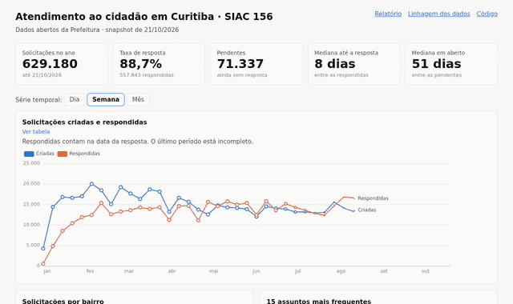
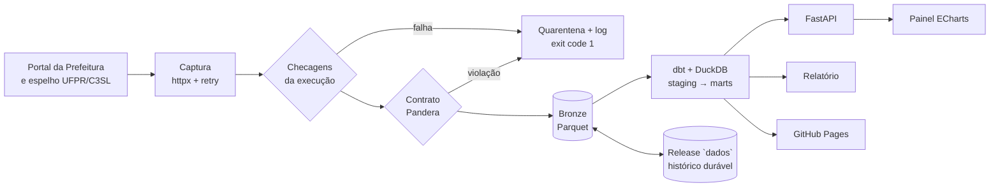

# CwbDataSIAC

[](https://github.com/MelsarDalRiFilho/CwbDataSIAC/actions/workflows/ci.yml)
[](https://github.com/MelsarDalRiFilho/CwbDataSIAC/actions/workflows/pages.yml)
[](https://github.com/MelsarDalRiFilho/CwbDataSIAC/actions/workflows/pages.yml)

[](LICENSE)

Pipeline de dados de ponta a ponta sobre o **SIAC 156**, a central de atendimento ao cidadão da
Prefeitura de Curitiba. Todo dia, um workflow baixa o arquivo aberto da Prefeitura, valida, modela
com dbt, testa e publica um painel, um relatório e a linhagem dos dados.

**[Painel ao vivo](https://melsardalrifilho.github.io/CwbDataSIAC/)** ·
[Relatório](https://melsardalrifilho.github.io/CwbDataSIAC/relatorio/) ·
[Linhagem (dbt docs)](https://melsardalrifilho.github.io/CwbDataSIAC/dbt/)



## O que os dados mostram

No snapshot de 21/10/2026 (629 mil solicitações em 2026); o relatório ao vivo recalcula tudo a cada dia:

- **88,7% das solicitações foram respondidas**, com mediana de 8 dias. Mas os 71 mil pedidos
  pendentes estão abertos há uma mediana de 51 dias: olhar só a mediana de quem foi respondido faz
  o atendimento parecer mais rápido do que é.
- **A demanda é concentrada.** A Secretaria do Meio Ambiente recebe 45% de tudo, e só "Coleta"
  responde por um terço das solicitações.
- **O gargalo tem nome.** Entre os órgãos com mais de 1.000 pedidos, o Urbanismo responde só 50%, e
  seus pendentes estão parados há uma mediana de 99 dias.
- **O telefone ainda é o canal principal** (56%), e em dias úteis entram mais que o dobro de pedidos
  dos fins de semana.

## Como funciona



| Camada | Ferramentas | Destaque |
| --- | --- | --- |
| Captura | httpx, tenacity, Playwright (opcional) | 3 estratégias de descoberta, checksum, idempotente |
| Validação | Pandera, checagens próprias | regras bloqueantes com tolerância e alertas de domínio |
| Armazenamento | Parquet (Bronze), DuckDB | 123 MB de CSV viram 6 MB de Parquet por dia |
| Modelagem | dbt-duckdb | modelo estrela, histórico incremental, 42 testes de dados |
| Serviço | FastAPI, Pydantic | 13 rotas somente leitura, convive com o pipeline gravando |
| Apresentação | Apache ECharts, Jinja2 | painel e relatório com paleta acessível, claro e escuro |
| Operação | GitHub Actions, Pages | atualização diária, issue automática quando falha |

## Decisões técnicas

- **Não há número de protocolo, e cerca de 39 mil linhas são idênticas e legítimas.** Por isso o
  projeto nunca deduplica: o fato é o retrato do último arquivo, e o histórico é guardado como
  contagens agregadas por snapshot ([ADR 0001](docs/adr/0001-chave-e-historico-das-solicitacoes.md)).
- **A fonte muda sem avisar.** A captura passa por checagens (conteúdo, cabeçalho, volume) e por um
  contrato Pandera. Arquivos ruins vão para a quarentena, e toda execução vira uma linha numa tabela
  de controle com o `run_id` do log.
- **O bairro não determina a regional** (13 bairros aparecem em duas ou três), então a dimensão de
  lugar tem o grão bairro × regional.
- **O DuckDB não deixa ler e gravar ao mesmo tempo entre processos.** A API usa conexões curtas e
  responde 503 durante a atualização; o pipeline espera o lock. Num teste de estresse, isso levou a
  taxa de gravações barradas de 70% para zero falhas.
- **Sem servidor pago.** O site é estático no GitHub Pages, o histórico durável fica numa release do
  próprio repositório, e o warehouse é reconstruído a partir dele quando preciso.
- **LGPD.** O endereço da solicitação nunca sai do warehouse; o menor recorte publicado é o bairro.

## Qualidade

- **Testes:** mais de 130 testes pytest, com cobertura acima de 95%. O dbt e a API rodam de verdade
  sobre uma Bronze sintética, sem rede, e há testes de falhas reais: HTTP 500, arquivo truncado,
  coluna faltando, banco travado por outro processo.
- **Testes de dados no dbt:** chaves, relacionamentos, fato e histórico batendo com a Bronze (falham
  o build) e regras de qualidade (só avisam), além de um teste unitário do staging.
- **Integração contínua:** lint (ruff), testes e `dbt build` em cada push; pre-commit local.
- **Observabilidade:** logs JSON com `run_id`, tabelas `controle.ingestao_execucoes` e
  `controle.contrato_violacoes`, e rota `/qualidade`.

## Como rodar

Requisitos: [uv](https://docs.astral.sh/uv/) (instala o Python 3.12) e `make`.

```bash
make install    # dependências e hooks de pre-commit
make pipeline   # baixa o arquivo do dia, valida, grava a Bronze e roda o dbt
make api        # API em http://127.0.0.1:8000, painel em /painel, documentação em /docs
make site       # site estático em site/ (o mesmo que vai para o Pages)
make check      # lint e testes
```

<details>
<summary><b>Detalhes da ingestão</b></summary>

`cwbdatasiac ingest` registra cada etapa em log JSON (`logs/cwbdatasiac.log`) com o mesmo `run_id`
e numa linha de `controle.ingestao_execucoes`:

1. **Descoberta:** manifesto `156.xml` do espelho C3SL → endpoint JSON do portal oficial →
   navegador headless (Playwright, `make install-browser`).
2. **Download:** retry com backoff em 5xx, 429 e erros de rede; sha256; escrita atômica.
3. **Checagens:** tipo e tamanho do conteúdo, BOM UTF-8, cabeçalho, conteúdo idêntico ao snapshot
   anterior e volume (o arquivo acumula o ano, então não pode encolher).
4. **Contrato:** obrigatórios, datas válidas dentro do ano e resposta ≥ criação são bloqueantes,
   acima de 0,1% de linhas; valores novos de Tipo, Situação, Origem e Regional só geram alerta.
5. **Bronze:** Parquet em `data/bronze/siac156/snapshot_data=AAAA-MM-DD/`. O CSV bruto fica só para
   as 3 datas mais recentes.

Rodar de novo não duplica nada (`sem_novidade`). Em caso de falha, o arquivo vai para
`data/quarentena/` e o comando termina com exit code 1.
</details>

<details>
<summary><b>Detalhes da modelagem (dbt)</b></summary>

- `staging.stg_siac156__solicitacoes`: tipagem, nomes padronizados por seed, sem deduplicação.
- `marts.fct_solicitacoes`: o último snapshot, uma linha por solicitação, sem endereço.
- `marts.fct_snapshot_agregado`: histórico incremental (`delete+insert` por snapshot).
- Dimensões `dim_orgao`, `dim_assunto`, `dim_localidade`, `dim_origem` e `dim_data`.
- Agregados `agg_diario` e `agg_tempo_resposta`, este com os pendentes ao lado da mediana.
</details>

<details>
<summary><b>Rotas da API</b></summary>

| Rota | Conteúdo |
| --- | --- |
| `/health`, `/ingestoes`, `/qualidade` | snapshot servido, execuções e violações do contrato |
| `/solicitacoes` | último snapshot com filtros e paginação (sem endereço) |
| `/indicadores/resumo` | KPIs |
| `/indicadores/serie-temporal` | criadas e respondidas por dia, semana ou mês |
| `/indicadores/por-orgao`, `/por-assunto`, `/por-bairro`, `/por-origem` | rankings |
| `/indicadores/tempo-resposta` | mediana, p90 e pendentes por órgão |
| `/indicadores/historico-situacao` | situação em cada snapshot |
| `/indicadores/dia-semana-mes` | mapa de calor de mês × dia da semana |
</details>

<details>
<summary><b>Atualização diária</b></summary>

O workflow [Atualização diária](.github/workflows/pages.yml) roda às 06h30 (Brasília), uma hora
depois de a Prefeitura publicar o arquivo do dia anterior:

1. Restaura a Bronze a partir dos assets da release `dados` (um Parquet por snapshot).
2. Roda ingestão, `dbt build`, documentação e testes.
3. Publica os snapshots novos na release e o site no Pages.

Se algo falha, uma issue "Falha na atualização diária" é aberta (ou recebe um comentário) e é
fechada automaticamente na primeira execução bem-sucedida.
</details>

## Estrutura

```
src/cwbdatasiac/   ingestão, contrato, runner do dbt, API, site e relatório
dbt/siac156/       projeto dbt (staging, marts, seeds, testes)
dashboard/         painel ECharts estático e GeoJSON dos bairros
tests/             testes pytest
notebooks/         exploração da fonte
docs/              demanda, plano por fases e ADRs
scripts/           GeoJSON dos bairros e badge de cobertura
```

## Próximos passos

- Carga histórica de 2016 a 2025 a partir do espelho C3SL (os arquivos antigos têm outro layout).
- Orquestração com Dagster, com sensores no lugar do agendamento fixo.
- PostgreSQL ou um banco só de leitura publicado, se a API precisar de mais tráfego.
- Indicadores normalizados por população de cada bairro (dados do IBGE).

## Licença e créditos

- **Código:** [MIT](LICENSE).
- **Dados:** Prefeitura Municipal de Curitiba, [dados abertos do SIAC 156](https://dadosabertos.curitiba.pr.gov.br/conjuntodado/detalhe/?chave=0d5a7b06-3940-4be9-876e-bc8f23e96530)
  (CC BY 4.0), espelhados pela UFPR/C3SL.
- **Divisa de bairros:** [IPPUC](https://ippuc.org.br/geodownloads/geo.htm).
- Plano completo e decisões em [docs/data_siac_plano.md](docs/data_siac_plano.md).
