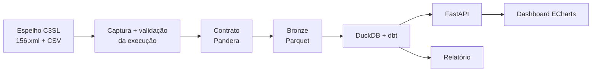

# CwbDataSIAC

[](https://github.com/MelsarDalRiFilho/CwbDataSIAC/actions/workflows/ci.yml)

Pipeline de engenharia de dados sobre os dados abertos da Prefeitura de Curitiba, começando pelo
**SIAC 156**, o Sistema Integrado de Atendimento ao Cidadão. O projeto cobre o caminho completo:
captura da fonte, validação, armazenamento, modelagem com dbt, API em FastAPI e dashboard em
Apache ECharts.

> 🚧 Em construção. Veja o [plano por fases](docs/data_siac_plano.md) e o andamento abaixo.

## A fonte

- [Conjunto SIAC 156](https://dadosabertos.curitiba.pr.gov.br/conjuntodado/detalhe/?chave=0d5a7b06-3940-4be9-876e-bc8f23e96530)
  no portal de dados abertos (licença CC BY 4.0), espelhado pela UFPR/C3SL.
- Um CSV por dia, com o **acumulado do ano corrente**: cerca de 626 mil linhas e 123 MB em outubro de 2026.
- Não há número de protocolo e as datas vêm sem hora. Por isso o projeto **não deduplica** e guarda o
  histórico de forma agregada. Detalhes em [ADR 0001](docs/adr/0001-chave-e-historico-das-solicitacoes.md)
  e no [notebook de exploração](notebooks/00_exploracao.ipynb).

## Arquitetura prevista



## Como rodar

Requisitos: [uv](https://docs.astral.sh/uv/) (instala o Python 3.12 automaticamente) e `make`.

```bash
make install   # dependências + hooks de pre-commit
make check     # lint (ruff) + testes (pytest, cobertura mínima de 80%)
make ingest    # baixa o snapshot mais recente, valida e grava no Bronze
make transform # dbt build: modelos e testes sobre a Bronze
make docs      # documentação e linhagem do dbt (dbt/siac156/target/static_index.html)
make pipeline  # ingest + transform
uv run cwbdatasiac --help
```

### Ingestão

`cwbdatasiac ingest` executa estas etapas, todas registradas em log JSON (`logs/cwbdatasiac.log`) com
o mesmo `run_id` e numa linha da tabela `controle.ingestao_execucoes` (`data/warehouse.duckdb`):

1. **Descoberta** do arquivo do dia: manifesto `156.xml` do espelho C3SL → endpoint JSON do portal
   oficial → navegador headless (Playwright, opcional: `make install-browser`).
2. **Download** com retry e backoff em erros 5xx e de rede, sha256 e escrita atômica.
3. **Checagens:** tipo e tamanho do conteúdo, BOM UTF-8, colunas do cabeçalho, conteúdo idêntico ao
   snapshot anterior e volume (o arquivo acumula o ano, então não pode encolher).
4. **Contrato de entrada (Pandera):** obrigatórios, datas válidas e dentro do ano do snapshot,
   resposta ≥ criação (bloqueantes, com tolerância de 0,1% de linhas) e domínios conhecidos de Tipo,
   Situação, Origem e Regional (só alerta). As violações vão para o log, para
   `controle.contrato_violacoes` e para um relatório JSON em `data/qualidade/`.
5. **Bronze:** Parquet em `data/bronze/siac156/snapshot_data=AAAA-MM-DD/`. O CSV bruto é mantido
   só para as 3 datas mais recentes.

Rodar de novo não duplica nada (status `sem_novidade`). Em caso de falha, o arquivo vai para
`data/quarentena/`, o log registra a etapa e o motivo, e o comando termina com exit code 1.

### Modelagem (dbt)

`cwbdatasiac transform` roda o projeto `dbt/siac156` (dbt-duckdb) e grava em `data/warehouse.duckdb`:

- `staging.stg_siac156__solicitacoes`: tipagem, padronização de nomes por seed e nenhuma deduplicação.
- `marts.fct_solicitacoes`: retrato do último snapshot, uma linha por solicitação, sem endereço.
- `marts.fct_snapshot_agregado`: histórico incremental com contagens por snapshot e dimensões.
- Dimensões `dim_orgao`, `dim_assunto`, `dim_localidade` (bairro × regional), `dim_origem` e `dim_data`.
- Agregados `agg_diario` e `agg_tempo_resposta`. Este último mostra os pendentes ao lado da mediana,
  porque a mediana só enxerga quem já foi respondido.

Os testes de integridade (chaves, relacionamentos, fato e agregado reproduzindo a Bronze) falham o
build; os de qualidade que o contrato de entrada já tolera só avisam.

Para reexecutar a exploração, baixe os arquivos para `data/raw/` (instruções no início do notebook) e rode `make explore`.

## Andamento

| Fase | Status |
| --- | --- |
| 1. Exploração e decisões | ✅ |
| 2. Esqueleto e CI | ✅ |
| 3. Ingestão, validação da execução e Bronze | ✅ |
| 4. Contrato e validação de entrada | ✅ |
| 5. dbt | ✅ |
| 6. FastAPI | ⏳ |
| 7. Dashboard ECharts e relatório | ⏳ |
| 8. Automação e vitrine | ⏳ |

## Estrutura

```
src/cwbdatasiac/      código do pipeline (CLI typer, ingestão, contrato, logging estruturado)
dbt/siac156/          projeto dbt (staging, marts, seeds, testes)
tests/                testes pytest (inclui dbt build sobre Bronze sintética)
notebooks/            exploração da fonte
docs/                 demanda, plano e decisões (ADRs)
data/, logs/          gerados localmente, fora do git
```
