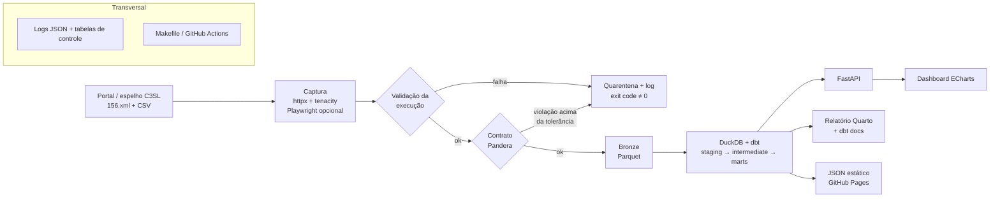
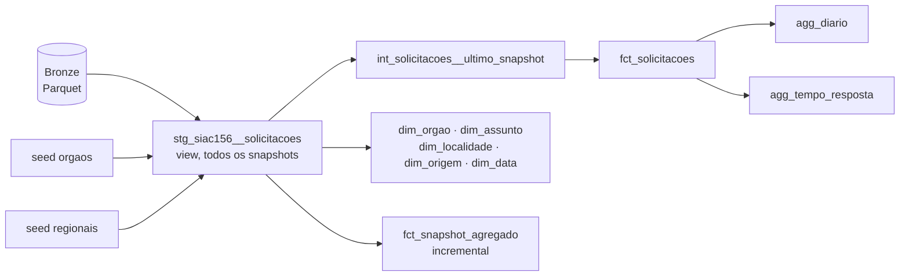

# Plano: projeto SIAC 156 Curitiba

Oct 21, 2026 · @Melsar José Dal Ri Filho

## Rastreabilidade dos requisitos

Cada item de [data_siac_demanda.md](data_siac_demanda.md) e onde ele é atendido neste plano.

| Requisito da demanda | Como é atendido | Onde | Fase |
| --- | --- | --- | --- |
| Desenvolver em Python | Python 3.12, `uv`, `ruff`, `typer` | Arquitetura e stack | 2 |
| Camada de obtenção dos dados da fonte | Descoberta pelo manifesto + download `httpx`/`tenacity`; Playwright opcional | Arquitetura e stack | 3 |
| Validar se o serviço executou corretamente; senão, gerar log | Checagens pós-captura, log estruturado, tabela `ingestao_execucoes`, exit code ≠ 0 | Validação da execução e logs | 3 |
| Utilizar FastAPI | API somente leitura sobre a camada Gold | Endpoints da API | 6 |
| Armazenar os dados | Bronze em CSV + Parquet; warehouse DuckDB | Arquitetura e stack | 3 e 5 |
| Aplicar dbt | `dbt-duckdb`: staging, intermediate, marts, histórico agregado incremental | Modelagem dbt | 5 |
| Validar os dados | Pandera na entrada; testes dbt + `dbt-expectations` na saída | Arquitetura e stack | 4 e 5 |
| Apresentar relatório e dashboard em Apache ECharts | Relatório Quarto + painel ECharts (local e GitHub Pages) | Painéis no ECharts | 7 |
| Escrever testes | pytest (unitários, integração, API, falhas) + testes dbt, cobertura ≥ 80% | Estratégia de testes | 2 a 7 |

## Avaliação da fonte

A fonte é ótima para portfólio: CSV público, atualizado todo dia, volume real (\~123 MB, \~626 mil linhas) e licença CC BY 4.0. Nenhum navegador é necessário para baixar os dados; o Playwright entra só como módulo opcional de descoberta do link, com justificativa no README.

| Item | O que encontrei |
| --- | --- |
| Arquivo atual | `AAAA-MM-DD_156_-_Base_de_Dados.csv`, 123,5 MB e 626.517 linhas em 20/10/2026 (cerca de +2,8 mil linhas/dia) |
| Frequência | Diária: o arquivo do dia D é publicado por volta das 05h30 de D+1 e já inclui o próprio dia D |
| Cobertura | **Confirmado:** acumulado do ano corrente (01/01 até o dia do arquivo), não um incremento |
| Formato | **Confirmado:** UTF-8 com BOM, CRLF, separador `;`, com um `;` extra no fim da linha (gera a coluna vazia) |
| Datas | **Confirmado:** `dd/mm/aaaa` **sem hora**, todas válidas; nenhuma `DataResposta` anterior a `DataCriacao`; \~11% sem resposta |
| Dicionário | `2024-11-26_156_-_Dicionario_de_Dados.xlsx` (11 colunas, todas `varchar`; a ordem real é `…Regional, DataResposta, Origem`) |
| Colunas | Tipo, Orgao, DataCriacao, Assunto, Subdivisao, Situacao, Logradouro, Bairro, Regional, DataResposta, Origem + uma coluna vazia sem nome |
| Domínios | Tipo (7), Situacao (6), Origem (5), Regional (10), Orgao (31), Assunto (239), Bairro (75) |
| Qualidade | 93 linhas sem Bairro/Regional (o dicionário diz NOT NULL); a caixa do `Orgao` varia entre órgãos; `Regional` sem acentos |
| Chave primária | **Não existe** e não é derivável: cerca de 39 mil linhas idênticas legítimas, e campos "estáveis" editados de um dia para o outro. Ver [ADR 0001](adr/0001-chave-e-historico-das-solicitacoes.md) |
| Histórico | Espelho da UFPR/C3SL via HTTP e rsync, com arquivos mensais 2014–2022 e anuais (ex.: `156_-_Base_de_Dados_2023.csv`) |
| Manifesto | `156.xml` no espelho lista o nome de cada arquivo diário (último: 2026-10-20) |
| API | Nenhuma |

**Descoberta do link.** No portal, o botão DOWNLOAD não expõe a URL no HTML estático: ele chama o endpoint JSON `/ConjuntoDado/DownloadArquivos/`, que devolve uma tabela HTML com as URLs oficiais em `mid-dadosabertos.curitiba.pr.gov.br/156/`. O arquivo de lá é idêntico ao do C3SL (mesmo tamanho e `Last-Modified`). A descoberta tenta, em ordem: (1) manifesto `156.xml` do C3SL; (2) endpoint JSON do portal, via `httpx`; (3) **Playwright opcional** (extra `[browser]`), que fecha o tutorial guiado, abre a aba "Dados", clica em DOWNLOAD e lê a tabela do modal. São duas fontes HTTP independentes, e o navegador fica como último recurso caso o JSON do portal mude.

**Resultado da fase 1** ([notebook](../notebooks/00_exploracao.ipynb)): os pontos em aberto foram confirmados na tabela acima. O arquivo de hoje **não** contém exatamente as linhas de ontem: de 19 para 20/10, 275 linhas mudaram campos estáveis ou sumiram, e 3.097 entraram (a maioria do próprio dia, algumas retroativas).

Fontes: [página do conjunto](https://dadosabertos.curitiba.pr.gov.br/conjuntodado/detalhe/?chave=0d5a7b06-3940-4be9-876e-bc8f23e96530), [espelho C3SL](http://dadosabertos.c3sl.ufpr.br/curitiba/156/), [manifesto 156.xml](http://dadosabertos.c3sl.ufpr.br/curitiba/156/156.xml).

## Arquitetura e stack

Recomendo uma arquitetura medalhão local e sem custo: Python baixa o CSV, guarda o bruto em Parquet, o dbt modela dentro do DuckDB, a FastAPI serve a camada Gold e o dashboard em ECharts consome a API. Tudo roda com `docker compose up` ou `make all`, o que facilita para quem avaliar o repositório.



O fluxo segue a arquitetura medalhão; logs, controle de execuções e orquestração acompanham todas as etapas.

| Item pedido | Escolha | Por quê |
| --- | --- | --- |
| 1. Python | Python 3.12 (`requires-python >=3.12`, `.python-version`), `uv`, `ruff`, `pytest`, `typer` (CLI) | Padrão atual de mercado, compatível com dbt e Pandera, setup em um comando |
| 2. Captura | `httpx` + `tenacity` (principal); Playwright opcional, extra `[browser]` (descoberta do link) | Download direto é mais confiável; navegador só onde agrega |
| 3. Validação da execução | Checagens pós-captura + `logging` estruturado em JSON + tabela de controle | Requisito explícito: detectar falha e gerar log |
| 4. FastAPI | FastAPI + Pydantic v2, documentação OpenAPI automática | Endpoints de indicadores, filtros e paginação |
| 5. Armazenamento | Bronze: Parquet zstd de todo snapshot (\~5,8 MB cada) + CSV bruto só das 3 datas mais recentes. Warehouse: DuckDB | Arquivo único, rápido para 123 MB, zero infraestrutura, sem gastar \~45 GB/ano com CSV |
| 6. dbt | `dbt-duckdb`, camadas staging, intermediate, marts + modelo incremental de histórico agregado | Mostra modelagem dimensional e materialização incremental, sem chave falsa (ADR 0001) |
| 7. Validação dos dados | Pandera no contrato de entrada; testes do dbt + `dbt-expectations`; relatório de qualidade | Validação em duas portas: antes de carregar e depois de transformar |
| 8. Relatório | Quarto (ou Jinja2) gerando HTML/PDF a partir da Gold; `dbt docs` publicado | Relatório analítico com achados + documentação de linhagem |
| 9. Dashboard | Apache ECharts em HTML/JS estático, servido pela FastAPI e publicado no GitHub Pages | Demo ao vivo no README sem servidor pago |
| 10. Testes | `pytest`, `pytest-cov`, `respx`, `TestClient`, testes dbt | Cobertura de cada camada, inclusive cenários de falha |
| Orquestração | `Makefile` + GitHub Actions agendado (diário); Dagster como evolução opcional | Simples primeiro, escalável depois |

**Modelagem dbt** (implementada na fase 5, conforme o [ADR 0001](adr/0001-chave-e-historico-das-solicitacoes.md)):



- **Staging** (`stg_siac156__solicitacoes`, view): tipagem `DATE`, trim, nomes de exibição de órgão e regional por seed, bairro e regional ausentes como `NÃO INFORMADO` e `Não informada`, `respondida` e `dias_ate_resposta`, **sem deduplicação**. É o único modelo com `logradouro`.
- **Fato atual** (`fct_solicitacoes`, tabela): o último snapshot, uma linha por solicitação, com `solicitacao_sk = md5(snapshot_data, linha)`, única só dentro do snapshot. Tem `dias_em_aberto` para pendentes e **não tem logradouro**.
- **Histórico** (`fct_snapshot_agregado`, incremental `delete+insert` por `snapshot_data`): `quantidade` e `respondidas` por snapshot × órgão × assunto/subdivisão × localidade × origem × tipo × situação. São cerca de 68 mil linhas por snapshot. Recarregar um snapshot antigo exige `--full-refresh`.
- **Dimensões:**
  - `dim_orgao`, `dim_assunto` (grão assunto × subdivisão), `dim_origem` e `dim_data` (calendário em português).
  - `dim_localidade` (grão **bairro × regional**): na fonte, 13 bairros aparecem em 2 ou 3 regionais, então a regional não pode ser atributo do bairro.
- **Agregados:** `agg_diario` (criadas e respondidas por dia, com zero nos dias vazios) e `agg_tempo_resposta` por órgão. Neste último, a mediana e o p90 consideram só as respondidas, e `pendentes` e `mediana_dias_em_aberto` aparecem ao lado para expor o viés de censura.

**Endpoints da API** (implementados na fase 6; documentação interativa em `/docs`):

| Rota | Conteúdo | Fonte |
| --- | --- | --- |
| `/health` | `ok` ou `indisponivel` e o snapshot servido (sempre 200) | `fct_solicitacoes` |
| `/ingestoes` | execuções da ingestão, filtro por `status` | `controle.ingestao_execucoes` |
| `/qualidade` | última ingestão, última carga e as violações de contrato dessa carga | tabelas de `controle` |
| `/solicitacoes` | linhas do último snapshot, sem logradouro; filtros por órgão, assunto, bairro, regional, origem, tipo, situação, respondida e período; paginação (`tamanho` ≤ 500) | fato + dimensões |
| `/indicadores/resumo` | KPIs: total, respondidas, pendentes, taxa, medianas de resposta e de pendência | `fct_solicitacoes` |
| `/indicadores/serie-temporal` | criadas e respondidas por dia, semana ou mês | `agg_diario` |
| `/indicadores/por-orgao`, `/por-assunto`, `/por-bairro` | rankings (o treemap usa `/por-assunto`) | fato + dimensões |
| `/indicadores/tempo-resposta` | mediana, p90, pendentes e idade dos pendentes por órgão | `agg_tempo_resposta` |
| `/indicadores/historico-situacao` | quantidade por situação em cada snapshot | `fct_snapshot_agregado` |
| `/indicadores/dia-semana-mes` | mapa de calor de mês × dia da semana | fato + `dim_data` |

**Concorrência com o pipeline.** O DuckDB não aceita leitores de outro processo enquanto alguém grava, nem o contrário.
- **Lado da API:** cada consulta abre uma conexão somente leitura e a fecha em milissegundos. Se o arquivo estiver travado, a resposta é **503** com `Retry-After: 10`.
- **Lado do pipeline:** a ingestão e o dbt tentam de novo, com espera aleatória, por até 60 s (`warehouse_lock.py`).
- **Por que o lado do pipeline foi necessário:** medido com a API sob tráfego contínuo, cerca de 70% das tentativas de abrir o banco para gravar eram barradas.

**Painéis no ECharts.** Cartões de KPI (total, % respondidas, mediana de dias até resposta); linha diária de solicitações; evolução diária de solicitações em aberto (do histórico agregado); barras dos 15 assuntos mais frequentes; treemap órgão → assunto; mapa de calor dia da semana × mês (a fonte não tem hora); boxplot do tempo de resposta por órgão; mapa coroplético por bairro (exige o GeoJSON de bairros do IPPUC, a confirmar).

## Validação da execução e logs

A demanda pede que a camada de obtenção valide se o serviço foi executado corretamente e, caso não tenha sido, gere log. Cada execução da captura recebe um `run_id` e passa pelas checagens abaixo. A primeira falha interrompe a carga, e cada checagem registra status `ok` ou `falha` com o motivo.

| Checagem | Regra | Em caso de falha |
| --- | --- | --- |
| Descoberta | arquivo do dia encontrado por manifesto → portal JSON → navegador (se habilitado) | log `WARNING` por estratégia; `ERROR`, etapa `descoberta` se todas falharem |
| Idempotência | snapshot já carregado com sucesso e partição presente → `sem_novidade` sem baixar (`--forcar` recarrega) | — |
| Resposta HTTP | status 200; 5xx, 429 e erros de rede têm 3 tentativas com backoff; 4xx falha na hora | log `ERROR`, etapa `download` |
| Conteúdo | `Content-Type` `text/csv`, `text/plain` ou `application/octet-stream` (host oficial); BOM UTF-8; tamanho ≥ 50 MB | quarentena + log `ERROR`, etapa `conteudo` |
| Cabeçalho | as 11 colunas esperadas, sem faltantes nem extras | quarentena + log `ERROR`, etapa `cabecalho` |
| Integridade | sha256 igual ao do último snapshot carregado → a fonte não atualizou: `sem_novidade` (não é erro) | log `WARNING` |
| Leitura | CSV parseável pelo Arrow (nº de colunas consistente) | quarentena + log `ERROR`, etapa `leitura` |
| Volume | linhas > 0 e ≥ snapshot anterior (arquivo acumulado do ano), exceto na virada do ano | quarentena + log `ERROR`, carga não promovida |
| Contrato | regras Pandera (seção abaixo); fração de linhas inválidas ≤ tolerância (padrão 0,1%) | quarentena + relatório + log `ERROR`, etapa `contrato` |

**Contrato de entrada** (`validation/contracts.py`), aplicado antes de gravar a Bronze:

| Regra | Colunas | Severidade |
| --- | --- | --- |
| `not_nullable` | Tipo, Orgao, DataCriacao, Assunto, Subdivisao, Situacao, Origem. Bairro e Logradouro aceitam nulo, apesar do dicionário, porque a fonte tem nulos legítimos | bloqueante |
| `data_valida` | DataCriacao, DataResposta no formato `dd/mm/aaaa` e datas existentes | bloqueante |
| `data_no_ano_do_snapshot` | datas entre 1º/jan do ano do snapshot e a data do snapshot | bloqueante |
| `resposta_apos_criacao` | DataResposta ≥ DataCriacao (ignora datas já inválidas) | bloqueante |
| tipo das colunas | todas texto | bloqueante, sempre, independentemente da tolerância |
| `dominio_conhecido` | Tipo, Situacao, Origem e Regional nos valores conhecidos | alerta: carrega, registra e avisa (um canal novo é legítimo) |

- Linhas inválidas abaixo da tolerância (`--tolerancia-contrato`, padrão 0,001) são carregadas como vieram, porque não descartamos linhas (ADR 0001), e ficam registradas.
- Toda violação vai para o log (`WARNING`), para a tabela `controle.contrato_violacoes` e para o relatório `data/qualidade/contrato_<snapshot>_<run_id>.json`. Os exemplos mostram só as colunas da regra; `Logradouro` nunca aparece (LGPD).

- **Logging estruturado** com `logging` da stdlib e formatter JSON (ou `structlog`), configurado em `observability/logging.py`. A saída vai para o console e para um arquivo rotativo em `logs/`, com `run_id`, etapa, duração e contexto em todas as mensagens.
- **Tabela de controle `ingestao_execucoes`** no DuckDB: `run_id`, início, fim, status (`sucesso`, `sem_novidade`, `falha`), etapa da falha, mensagem, bytes, linhas e sha256. A API a expõe em `/ingestoes`.
- **Exit code ≠ 0** na CLI quando há falha, para que o GitHub Actions marque o job como falho e envie notificação.

## Estratégia de testes

| Camada | O que testar | Ferramentas |
| --- | --- | --- |
| Captura | Parsing do `156.xml`, retries, timeouts, respostas 404/500, checksum e idempotência | `pytest`, `respx` (mock do `httpx`) |
| Validação da execução | Cada checagem falhando gera log, registro `falha` em `ingestao_execucoes` e exit code ≠ 0 | `pytest`, `caplog`, `typer.testing.CliRunner` |
| Bronze | CSV → Parquet preserva linhas e tipos; reexecução não duplica | `pytest` + amostra em `tests/fixtures/` |
| Contrato de entrada | CSV válido passa; coluna faltando, data inválida ou domínio fora da lista falham com mensagem clara | Pandera |
| dbt | `dbt build` real sobre uma Bronze sintética (2 ou 3 snapshots, com linhas idênticas), incremental e falha. Dentro do dbt: 42 testes de dados e 1 teste unitário do staging. Os testes de integridade (chaves, `relationships`, fato = Bronze, soma do agregado = Bronze por snapshot) falham o build; os de qualidade que o contrato já tolera (`accepted_values`, `DataResposta >= DataCriacao`) são `warn` | `dbt-duckdb`, testes nativos + `expression_is_true` próprio, pytest (`-m slow`) |
| API | Status, valores exatos, filtros, paginação, 422 em parâmetros inválidos, 503 com warehouse ausente ou travado por outro processo, ausência de logradouro | `TestClient` sobre um warehouse real (Bronze sintética + `dbt build` em subprocesso) |
| Concorrência | Espera pelo lock com retry, erro de lock embrulhado pelo dbt, desistência após o tempo limite, leitor real em outro processo | `pytest` + subprocesso |

O CI roda tudo com uma amostra pequena do CSV versionada em `tests/fixtures/` e exige cobertura mínima de 80% (`pytest-cov`).

## Estrutura do repositório

Repositório único `CwbDataSIAC`, com cada etapa em sua pasta e um README que conta a história de ponta a ponta.

```
CwbDataSIAC/
├── README.md                  # vitrine: diagrama, GIF do dashboard, como rodar, achados
├── pyproject.toml / uv.lock
├── Makefile                   # make ingest | transform | test | api | report | all
├── docker-compose.yml         # api + dashboard
├── .github/workflows/
│   ├── ci.yml                 # lint, testes, dbt build em amostra
│   └── daily.yml              # cron: ingest → dbt → export JSON → GitHub Pages
├── src/cwbdatasiac/
│   ├── cli.py                 # typer
│   ├── observability/logging.py  # logging JSON, run_id, handlers console + arquivo
│   ├── config.py              # URLs da fonte, colunas esperadas, IngestSettings
│   ├── ingestion/
│   │   ├── pipeline.py        # orquestra as etapas, quarentena e retenção do raw/
│   │   ├── discovery.py       # manifesto 156.xml → portal JSON → navegador
│   │   ├── browser.py         # descoberta via Playwright (extra opcional)
│   │   ├── download.py        # httpx + tenacity, sha256, escrita atômica
│   │   ├── checks.py          # checagens pós-captura
│   │   ├── control.py         # tabela controle.ingestao_execucoes
│   │   └── bronze.py          # CSV → Parquet particionado por snapshot
│   ├── validation/contracts.py  # schema Pandera da entrada
│   ├── api/                   # FastAPI: main.py, routers/, schemas.py, db.py (conexão curta)
│   ├── transform.py           # dbtRunner + espera pelo lock
│   ├── warehouse_lock.py      # retry de escrita quando a API está lendo
│   └── export/static_json.py  # gera JSON para o dashboard no Pages
├── dbt/siac156/
│   ├── models/staging | intermediate | marts
│   ├── tests/  macros/  seeds/   # seeds: nomes de exibição de órgãos e regionais
│   └── dbt_project.yml, profiles.yml   # caminho dos dados via CWBDATASIAC_DATA_DIR
├── dashboard/                 # index.html + js/ com Apache ECharts
├── reports/                   # relatório Quarto (.qmd) e saídas
├── notebooks/00_exploracao.ipynb
├── tests/                     # pytest: unitários, integração, API, cenários de falha
│   └── fixtures/              # amostra do CSV (válida e quebrada)
├── docs/                      # demanda, plano, diagramas, decisões (ADRs)
├── logs/                      # ignorado no git
└── data/                      # ignorado no git: raw/, bronze/, quarentena/, qualidade/, warehouse.duckdb
```

## Fases de execução

Oito fases curtas, cada uma terminando num commit que funciona sozinho. Assim o repositório já tem valor desde a fase 2.

1. **Exploração e decisões.** Baixar 2 ou 3 arquivos diários seguidos e o dicionário; perfilar encoding, separador, nulos, cardinalidade e formato das datas; testar se existe uma combinação de colunas que identifica a solicitação. *Pronto quando:* notebook de exploração e um ADR com a chave escolhida. **✅ Concluída em 21/10/2026:** `notebooks/00_exploracao.ipynb` e `docs/adr/0001-chave-e-historico-das-solicitacoes.md`; o Python 3.12 e o grupo `explore` já foram antecipados no `pyproject.toml`.
2. **Esqueleto e CI.** `uv`, `ruff`, `pytest` + `pytest-cov`, pre-commit, configuração de logging, Makefile, workflow de CI, README inicial. *Pronto quando:* CI verde num repositório vazio de lógica. **✅ Concluída em 21/10/2026:** CLI `cwbdatasiac` (typer), logging JSON com `run_id` em `observability/logging.py`, ruff, pytest com cobertura mínima de 80%, pre-commit, `Makefile` e `.github/workflows/ci.yml`.
3. **Ingestão, validação da execução e Bronze.** Descoberta pelo manifesto, download com retry e checksum, checagens pós-captura, tabela `ingestao_execucoes`, conversão para Parquet, módulo Playwright opcional como estratégia alternativa. Carga histórica opcional pelo espelho C3SL. *Pronto quando:* `make ingest` é idempotente (rodar duas vezes não duplica) e uma falha simulada (HTTP 500, arquivo truncado, coluna faltando) gera log, registro `falha` e exit code ≠ 0. **✅ Concluída em 21/10/2026:** `cwbdatasiac ingest` / `make ingest`, validado contra a fonte real (cerca de 13 s por carga) e com 50 testes (99% de cobertura). A carga histórica foi adiada: os arquivos antigos têm outro layout e serão tratados depois do dbt.
4. **Contrato e validação de entrada.** Schema Pandera (colunas, tipos, datas válidas, domínios de Situação e Origem); carga rejeitada vai para quarentena com relatório. *Pronto quando:* um CSV com coluna faltando falha com mensagem clara. **✅ Concluída em 22/10/2026:** contrato com severidade bloqueante ou de alerta e tolerância percentual; a coluna faltando já é barrada pela checagem de cabeçalho da fase 3. O snapshot real de 21/10 (629.180 linhas) passou com 0 violações, e a validação leva cerca de 0,6 s. São 69 testes, com 99% de cobertura.
5. **dbt.** Staging, dimensões, fato do último snapshot, histórico agregado incremental e agregados; testes `not_null`, `unique`, `accepted_values`, `relationships` e regras como `DataResposta >= DataCriacao`; `dbt docs`. *Pronto quando:* `dbt build` verde e linhagem publicada. **✅ Concluída em 22/10/2026:** `cwbdatasiac transform` / `make transform` rodou com 56 de 56 nós verdes sobre os snapshots reais de 20 e 21/10 (cerca de 7 s), e `make docs` gera a linhagem em `dbt/siac156/target/static_index.html`. A publicação dessa página no GitHub Pages fica para a fase 8, junto com o dashboard. São 78 testes pytest, com 99% de cobertura.
6. **FastAPI.** Conexão somente leitura ao DuckDB, modelos Pydantic, filtros, paginação, testes com `TestClient`. *Pronto quando:* `/docs` mostra todos os endpoints e os testes passam. **✅ Concluída em 22/10/2026:** 12 rotas, `cwbdatasiac api` / `make api`, e de 20 a 70 ms por requisição sobre os dados reais. Num teste de estresse com a API sob tráfego contínuo, 5 de 5 `transform` e 3 de 3 `ingest` passaram, e a API respondeu 503 durante as gravações. São 113 testes, com 99% de cobertura.
7. **Dashboard ECharts e relatório.** Painel consumindo a API localmente e JSON estático no GitHub Pages; relatório Quarto com 5 a 8 achados (assuntos mais demandados, bairros, tempo de resposta por órgão, sazonalidade). *Pronto quando:* link público do dashboard funcionando.
8. **Automação e vitrine.** Workflow diário atualizando o Pages e notificando falhas, badges (CI, cobertura), diagrama de arquitetura, GIF do dashboard, seção "decisões técnicas" e "próximos passos" (Dagster, Postgres, Great Expectations). *Pronto quando:* o README conta a história em 2 minutos de leitura.

## Riscos e decisões

O maior risco técnico é a falta de identificador, e ele vira um bom tema para o README se for tratado com transparência.

| Risco | Impacto | Como tratar |
| --- | --- | --- |
| Sem número de protocolo (confirmado na fase 1) | Impossível deduplicar ou acompanhar o status de cada solicitação | Não deduplicar; fato do último snapshot + histórico agregado (ADR 0001); explicar no README |
| Arquivo cobre só o ano corrente | Histórico some na virada do ano | Guardar todos os snapshots no Bronze; carga histórica pelo espelho C3SL; checagem de volume tolera a virada do ano |
| Portal muda o layout ou o link | Captura quebra | Manifesto como fonte principal, Playwright como alternativa, log + alerta no workflow |
| Fonte indisponível ou arquivo corrompido | Carga parcial ou dados errados no dashboard | Checagens pós-captura, quarentena, dashboard mantém o último snapshot válido |
| `Logradouro` com endereço | Exposição desnecessária (LGPD) | Publicar agregados por bairro; endereço só na camada interna |
| 117 MB por dia no GitHub | Repositório pesado | Dados fora do git; Pages recebe só JSON agregado |
| API e pipeline disputando o arquivo do DuckDB | Pipeline falha ou API fica fora | Conexão curta na API (503 + `Retry-After`) e retry de até 60 s na escrita. Se o tráfego crescer, a evolução é publicar um banco separado só para leitura |

**Decisões tomadas:**

- Python 3.12, para garantir compatibilidade com dbt, Pandera e Quarto.
- Descoberta em cadeia: manifesto C3SL → portal JSON (`httpx`) → Playwright opcional.
- Bronze guarda o Parquet de todo snapshot e o CSV bruto só das 3 datas mais recentes (`--manter-csv-dias`).
- Carga histórica (2014–2025) adiada para depois da fase 5.
- Contrato: valores novos de domínio só geram alerta; regras estruturais bloqueiam acima de 0,1% de linhas inválidas.
- Sem chave por solicitação: fato do último snapshot + histórico agregado incremental ([ADR 0001](adr/0001-chave-e-historico-das-solicitacoes.md)).
- Testes do dbt nativos + `expression_is_true` próprio, sem `dbt-expectations`; dbt e API testados de verdade no pytest sobre uma Bronze sintética.
- API lê o mesmo `warehouse.duckdb` com conexões curtas por requisição; o pipeline espera o lock.

**Decisões em aberto** (minhas recomendações entre parênteses):

- DuckDB ou PostgreSQL como warehouse? (DuckDB; Postgres fica como "próximo passo")
- Dashboard publicado no GitHub Pages com dados estáticos? (sim, é o que dá a demo ao vivo)
