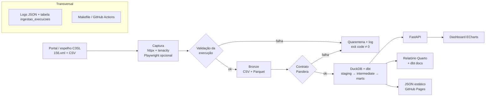

# Plano: projeto SIAC 156 Curitiba

Oct 21, 2026 · @Melsar José Dal Ri Filho

## Rastreabilidade dos requisitos

Cada item de [data_siac_demanda.md](data_siac_demanda.md) e onde ele é atendido neste plano.

| Requisito da demanda | Como é atendido | Onde | Fase |
| --- | --- | --- | --- |
| Desenvolver em Python | Python 3.12, `uv`, `ruff`, `typer` | Arquitetura e stack | 2 |
| Camada de obtenção dos dados da fonte | Descoberta pelo manifesto + download `httpx`/`tenacity`; Playwright opcional | Arquitetura e stack | 3 |
| Validar se o serviço executou corretamente; senão, gerar log | Checagens pós-captura, log estruturado, tabela `ingestao_execucoes`, exit code ≠ 0 | Validação da execução e logs | 3 |
| Utilizar FastAPI | API somente leitura sobre a camada Gold | Endpoints da API | 6 |
| Armazenar os dados | Bronze em CSV + Parquet; warehouse DuckDB | Arquitetura e stack | 3 e 5 |
| Aplicar dbt | `dbt-duckdb`: staging, intermediate, marts, histórico agregado incremental | Modelagem dbt | 5 |
| Validar os dados | Pandera na entrada; testes dbt + `dbt-expectations` na saída | Arquitetura e stack | 4 e 5 |
| Apresentar relatório e dashboard em Apache ECharts | Relatório Quarto + painel ECharts (local e GitHub Pages) | Painéis no ECharts | 7 |
| Escrever testes | pytest (unitários, integração, API, falhas) + testes dbt, cobertura ≥ 80% | Estratégia de testes | 2 a 7 |

## Avaliação da fonte

A fonte é ótima para portfólio: CSV público, atualizado todo dia, volume real (\~123 MB, \~626 mil linhas) e licença CC BY 4.0. Nenhum navegador é necessário para baixar os dados; o Playwright entra só como módulo opcional de descoberta do link, com justificativa no README.

| Item | O que encontrei |
| --- | --- |
| Arquivo atual | `AAAA-MM-DD_156_-_Base_de_Dados.csv`, 123,5 MB e 626.517 linhas em 20/10/2026 (cerca de +2,8 mil linhas/dia) |
| Frequência | Diária (publicação às 23h30); o arquivo já inclui o próprio dia |
| Cobertura | **Confirmado:** acumulado do ano corrente (01/01 até o dia do arquivo), não um incremento |
| Formato | **Confirmado:** UTF-8 com BOM, CRLF, separador `;`, com um `;` extra no fim da linha (gera a coluna vazia) |
| Datas | **Confirmado:** `dd/mm/aaaa` **sem hora**, todas válidas; nenhuma `DataResposta` anterior a `DataCriacao`; \~11% sem resposta |
| Dicionário | `2024-11-26_156_-_Dicionario_de_Dados.xlsx` (11 colunas, todas `varchar`; a ordem real é `…Regional, DataResposta, Origem`) |
| Colunas | Tipo, Orgao, DataCriacao, Assunto, Subdivisao, Situacao, Logradouro, Bairro, Regional, DataResposta, Origem + uma coluna vazia sem nome |
| Domínios | Tipo (7), Situacao (6), Origem (5), Regional (10), Orgao (31), Assunto (239), Bairro (75) |
| Qualidade | 93 linhas sem Bairro/Regional (o dicionário diz NOT NULL); a caixa do `Orgao` varia entre órgãos; `Regional` sem acentos |
| Chave primária | **Não existe** e não é derivável: cerca de 39 mil linhas idênticas legítimas, e campos "estáveis" editados de um dia para o outro. Ver [ADR 0001](adr/0001-chave-e-historico-das-solicitacoes.md) |
| Histórico | Espelho da UFPR/C3SL via HTTP e rsync, com arquivos mensais 2014–2022 e anuais (ex.: `156_-_Base_de_Dados_2023.csv`) |
| Manifesto | `156.xml` no espelho lista o nome de cada arquivo diário (último: 2026-10-20) |
| API | Nenhuma |

**Descoberta do link.** No portal, o botão DOWNLOAD não expõe a URL no HTML estático. Mas o `156.xml` já entrega o nome do arquivo do dia, e o espelho C3SL serve os arquivos por HTTP simples. Decisão: `httpx` como caminho principal e **Playwright opcional** (extra `[browser]`), que abre o portal em modo headless e captura a URL real do botão quando o manifesto falhar. Isso mostra a habilidade sem tornar o pipeline frágil.

**Resultado da fase 1** ([notebook](../notebooks/00_exploracao.ipynb)): os pontos em aberto foram confirmados na tabela acima. O arquivo de hoje **não** contém exatamente as linhas de ontem: de 19 para 20/10, 275 linhas mudaram campos estáveis ou sumiram, e 3.097 entraram (a maioria do próprio dia, algumas retroativas).

Fontes: [página do conjunto](https://dadosabertos.curitiba.pr.gov.br/conjuntodado/detalhe/?chave=0d5a7b06-3940-4be9-876e-bc8f23e96530), [espelho C3SL](http://dadosabertos.c3sl.ufpr.br/curitiba/156/), [manifesto 156.xml](http://dadosabertos.c3sl.ufpr.br/curitiba/156/156.xml).

## Arquitetura e stack

Recomendo uma arquitetura medalhão local e sem custo: Python baixa o CSV, guarda o bruto em Parquet, o dbt modela dentro do DuckDB, a FastAPI serve a camada Gold e o dashboard em ECharts consome a API. Tudo roda com `docker compose up` ou `make all`, o que facilita para quem avaliar o repositório.



O fluxo segue a arquitetura medalhão; logs, controle de execuções e orquestração acompanham todas as etapas.

| Item pedido | Escolha | Por quê |
| --- | --- | --- |
| 1. Python | Python 3.12 (`requires-python >=3.12`, `.python-version`), `uv`, `ruff`, `pytest`, `typer` (CLI) | Padrão atual de mercado, compatível com dbt e Pandera, setup em um comando |
| 2. Captura | `httpx` + `tenacity` (principal); Playwright opcional, extra `[browser]` (descoberta do link) | Download direto é mais confiável; navegador só onde agrega |
| 3. Validação da execução | Checagens pós-captura + `logging` estruturado em JSON + tabela de controle | Requisito explícito: detectar falha e gerar log |
| 4. FastAPI | FastAPI + Pydantic v2, documentação OpenAPI automática | Endpoints de indicadores, filtros e paginação |
| 5. Armazenamento | Bronze: CSV original + Parquet por data de snapshot. Warehouse: DuckDB | Arquivo único, rápido para 117 MB, zero infraestrutura |
| 6. dbt | `dbt-duckdb`, camadas staging, intermediate, marts + modelo incremental de histórico agregado | Mostra modelagem dimensional e materialização incremental, sem chave falsa (ADR 0001) |
| 7. Validação dos dados | Pandera no contrato de entrada; testes do dbt + `dbt-expectations`; relatório de qualidade | Validação em duas portas: antes de carregar e depois de transformar |
| 8. Relatório | Quarto (ou Jinja2) gerando HTML/PDF a partir da Gold; `dbt docs` publicado | Relatório analítico com achados + documentação de linhagem |
| 9. Dashboard | Apache ECharts em HTML/JS estático, servido pela FastAPI e publicado no GitHub Pages | Demo ao vivo no README sem servidor pago |
| 10. Testes | `pytest`, `pytest-cov`, `respx`, `TestClient`, testes dbt | Cobertura de cada camada, inclusive cenários de falha |
| Orquestração | `Makefile` + GitHub Actions agendado (diário); Dagster como evolução opcional | Simples primeiro, escalável depois |

**Modelagem dbt prevista** (conforme o [ADR 0001](adr/0001-chave-e-historico-das-solicitacoes.md)). `stg_siac156__solicitacoes`, com tipagem `DATE`, trim e padronização de caixa e acentos, **sem deduplicação**. O fato `fct_solicitacoes` é um retrato do último snapshot válido em full refresh, com `solicitacao_sk = hash(snapshot_data, nº da linha)`, única só dentro do snapshot. O modelo incremental `fct_snapshot_agregado` guarda as contagens por `snapshot_data × Tipo × Orgao × Assunto × Bairro × Origem × Situacao` e é o histórico do projeto. Completam a modelagem as dimensões `dim_orgao`, `dim_assunto`, `dim_bairro` (com Regional), `dim_origem` e `dim_data`, e os agregados `agg_diario` e `agg_tempo_resposta`. A mediana de dias até a resposta considera só as solicitações respondidas, o que causa viés nos meses recentes; os pendentes são exibidos à parte.

**Endpoints da API.** `/health`, `/ingestoes` (metadados e status de cada execução, lidos de `ingestao_execucoes`), `/solicitacoes` (filtros e paginação), `/indicadores/resumo`, `/indicadores/serie-temporal`, `/indicadores/por-orgao`, `/indicadores/por-bairro`, `/indicadores/tempo-resposta`, `/qualidade` (resultado dos testes da última carga).

**Painéis no ECharts.** Cartões de KPI (total, % respondidas, mediana de dias até resposta); linha diária de solicitações; evolução diária de solicitações em aberto (do histórico agregado); barras dos 15 assuntos mais frequentes; treemap órgão → assunto; mapa de calor dia da semana × mês (a fonte não tem hora); boxplot do tempo de resposta por órgão; mapa coroplético por bairro (exige o GeoJSON de bairros do IPPUC, a confirmar).

## Validação da execução e logs

A demanda pede que a camada de obtenção valide se o serviço foi executado corretamente e, caso não tenha sido, gere log. Cada execução da captura recebe um `run_id` e passa pelas checagens abaixo. A primeira falha interrompe a carga, e cada checagem registra status `ok` ou `falha` com o motivo.

| Checagem | Regra | Em caso de falha |
| --- | --- | --- |
| Descoberta | `156.xml` acessível e com o arquivo do dia (fallback Playwright, se habilitado) | log `ERROR`, etapa `descoberta` |
| Resposta HTTP | status 200 após os retries do `tenacity` | log `ERROR` com status e tentativas |
| Conteúdo | `Content-Type` `text/csv`, BOM UTF-8 e tamanho ≥ mínimo configurado (ex.: 50 MB) | arquivo vai para a quarentena |
| Integridade | sha256 calculado; igual ao último snapshot → status `sem_novidade` (não é erro) | log `WARNING` |
| Cabeçalho | colunas esperadas presentes (contrato de entrada) | quarentena + log `ERROR` |
| Volume | contagem de linhas ≥ snapshot anterior (arquivo acumulado do ano), exceto na virada do ano | log `ERROR`, carga não promovida |

- **Logging estruturado** com `logging` da stdlib e formatter JSON (ou `structlog`), configurado em `observability/logging.py`. A saída vai para o console e para um arquivo rotativo em `logs/`, com `run_id`, etapa, duração e contexto em todas as mensagens.
- **Tabela de controle `ingestao_execucoes`** no DuckDB: `run_id`, início, fim, status (`sucesso`, `sem_novidade`, `falha`), etapa da falha, mensagem, bytes, linhas e sha256. A API a expõe em `/ingestoes`.
- **Exit code ≠ 0** na CLI quando há falha, para que o GitHub Actions marque o job como falho e envie notificação.

## Estratégia de testes

| Camada | O que testar | Ferramentas |
| --- | --- | --- |
| Captura | Parsing do `156.xml`, retries, timeouts, respostas 404/500, checksum e idempotência | `pytest`, `respx` (mock do `httpx`) |
| Validação da execução | Cada checagem falhando gera log, registro `falha` em `ingestao_execucoes` e exit code ≠ 0 | `pytest`, `caplog`, `typer.testing.CliRunner` |
| Bronze | CSV → Parquet preserva linhas e tipos; reexecução não duplica | `pytest` + amostra em `tests/fixtures/` |
| Contrato de entrada | CSV válido passa; coluna faltando, data inválida ou domínio fora da lista falham com mensagem clara | Pandera |
| dbt | `dbt build` na amostra: `not_null` (Bairro com severidade *warn*), `unique` só em chaves de dimensão e em `solicitacao_sk`, `accepted_values`, `relationships`, `DataResposta >= DataCriacao`, contagem do fato = linhas do arquivo | `dbt-duckdb`, `dbt-expectations` |
| API | Status, schemas, filtros e paginação de cada endpoint | `TestClient` sobre DuckDB de teste |

O CI roda tudo com uma amostra pequena do CSV versionada em `tests/fixtures/` e exige cobertura mínima de 80% (`pytest-cov`).

## Estrutura do repositório

Repositório único `CwbDataSIAC`, com cada etapa em sua pasta e um README que conta a história de ponta a ponta.

```
CwbDataSIAC/
├── README.md                  # vitrine: diagrama, GIF do dashboard, como rodar, achados
├── pyproject.toml / uv.lock
├── Makefile                   # make ingest | transform | test | api | report | all
├── docker-compose.yml         # api + dashboard
├── .github/workflows/
│   ├── ci.yml                 # lint, testes, dbt build em amostra
│   └── daily.yml              # cron: ingest → dbt → export JSON → GitHub Pages
├── src/cwbdatasiac/
│   ├── cli.py                 # typer
│   ├── observability/logging.py  # logging JSON, run_id, handlers console + arquivo
│   ├── ingestion/
│   │   ├── discovery.py       # manifesto 156.xml + fallback Playwright opcional
│   │   ├── download.py        # httpx + tenacity, sha256, idempotência
│   │   ├── checks.py          # checagens pós-captura + registro em ingestao_execucoes
│   │   └── bronze.py          # CSV → Parquet particionado por snapshot
│   ├── validation/contracts.py  # schema Pandera da entrada
│   ├── api/                   # FastAPI: main.py, routers/, schemas.py, db.py
│   └── export/static_json.py  # gera JSON para o dashboard no Pages
├── dbt/siac156/
│   ├── models/staging | intermediate | marts
│   ├── tests/  macros/  seeds/   # seeds: de-para de bairros e nomes de exibição de órgãos
│   └── dbt_project.yml
├── dashboard/                 # index.html + js/ com Apache ECharts
├── reports/                   # relatório Quarto (.qmd) e saídas
├── notebooks/00_exploracao.ipynb
├── tests/                     # pytest: unitários, integração, API, cenários de falha
│   └── fixtures/              # amostra do CSV (válida e quebrada)
├── docs/                      # demanda, plano, diagramas, decisões (ADRs)
├── logs/                      # ignorado no git
└── data/                      # ignorado no git: bronze/, quarentena/, warehouse.duckdb
```

## Fases de execução

Oito fases curtas, cada uma terminando num commit que funciona sozinho. Assim o repositório já tem valor desde a fase 2.

1. **Exploração e decisões.** Baixar 2 ou 3 arquivos diários seguidos e o dicionário; perfilar encoding, separador, nulos, cardinalidade e formato das datas; testar se existe uma combinação de colunas que identifica a solicitação. *Pronto quando:* notebook de exploração e um ADR com a chave escolhida. **✅ Concluída em 21/10/2026:** `notebooks/00_exploracao.ipynb` e `docs/adr/0001-chave-e-historico-das-solicitacoes.md`; o Python 3.12 e o grupo `explore` já foram antecipados no `pyproject.toml`.
2. **Esqueleto e CI.** `uv`, `ruff`, `pytest` + `pytest-cov`, pre-commit, configuração de logging, Makefile, workflow de CI, README inicial. *Pronto quando:* CI verde num repositório vazio de lógica.
3. **Ingestão, validação da execução e Bronze.** Descoberta pelo manifesto, download com retry e checksum, checagens pós-captura, tabela `ingestao_execucoes`, conversão para Parquet, módulo Playwright opcional como estratégia alternativa. Carga histórica opcional pelo espelho C3SL. *Pronto quando:* `make ingest` é idempotente (rodar duas vezes não duplica) e uma falha simulada (HTTP 500, arquivo truncado, coluna faltando) gera log, registro `falha` e exit code ≠ 0.
4. **Contrato e validação de entrada.** Schema Pandera (colunas, tipos, datas válidas, domínios de Situação e Origem); carga rejeitada vai para quarentena com relatório. *Pronto quando:* um CSV com coluna faltando falha com mensagem clara.
5. **dbt.** Staging, dimensões, fato do último snapshot, histórico agregado incremental e agregados; testes `not_null`, `unique`, `accepted_values`, `relationships` e regras como `DataResposta >= DataCriacao`; `dbt docs`. *Pronto quando:* `dbt build` verde e linhagem publicada.
6. **FastAPI.** Conexão somente leitura ao DuckDB, modelos Pydantic, filtros, paginação, testes com `TestClient`. *Pronto quando:* `/docs` mostra todos os endpoints e os testes passam.
7. **Dashboard ECharts e relatório.** Painel consumindo a API localmente e JSON estático no GitHub Pages; relatório Quarto com 5 a 8 achados (assuntos mais demandados, bairros, tempo de resposta por órgão, sazonalidade). *Pronto quando:* link público do dashboard funcionando.
8. **Automação e vitrine.** Workflow diário atualizando o Pages e notificando falhas, badges (CI, cobertura), diagrama de arquitetura, GIF do dashboard, seção "decisões técnicas" e "próximos passos" (Dagster, Postgres, Great Expectations). *Pronto quando:* o README conta a história em 2 minutos de leitura.

## Riscos e decisões

O maior risco técnico é a falta de identificador, e ele vira um bom tema para o README se for tratado com transparência.

| Risco | Impacto | Como tratar |
| --- | --- | --- |
| Sem número de protocolo (confirmado na fase 1) | Impossível deduplicar ou acompanhar o status de cada solicitação | Não deduplicar; fato do último snapshot + histórico agregado (ADR 0001); explicar no README |
| Arquivo cobre só o ano corrente | Histórico some na virada do ano | Guardar todos os snapshots no Bronze; carga histórica pelo espelho C3SL; checagem de volume tolera a virada do ano |
| Portal muda o layout ou o link | Captura quebra | Manifesto como fonte principal, Playwright como alternativa, log + alerta no workflow |
| Fonte indisponível ou arquivo corrompido | Carga parcial ou dados errados no dashboard | Checagens pós-captura, quarentena, dashboard mantém o último snapshot válido |
| `Logradouro` com endereço | Exposição desnecessária (LGPD) | Publicar agregados por bairro; endereço só na camada interna |
| 117 MB por dia no GitHub | Repositório pesado | Dados fora do git; Pages recebe só JSON agregado |

**Decisões tomadas:**

- Python 3.12, para garantir compatibilidade com dbt, Pandera e Quarto.
- Playwright como módulo opcional de descoberta do link; o caminho principal é `httpx`.
- Sem chave por solicitação: fato do último snapshot + histórico agregado incremental ([ADR 0001](adr/0001-chave-e-historico-das-solicitacoes.md)).

**Decisões em aberto** (minhas recomendações entre parênteses):

- DuckDB ou PostgreSQL como warehouse? (DuckDB; Postgres fica como "próximo passo")
- Dashboard publicado no GitHub Pages com dados estáticos? (sim, é o que dá a demo ao vivo)
- Carregar o histórico desde 2014 ou só o ano corrente? (começar pelo ano corrente; histórico na fase 3 opcional)
